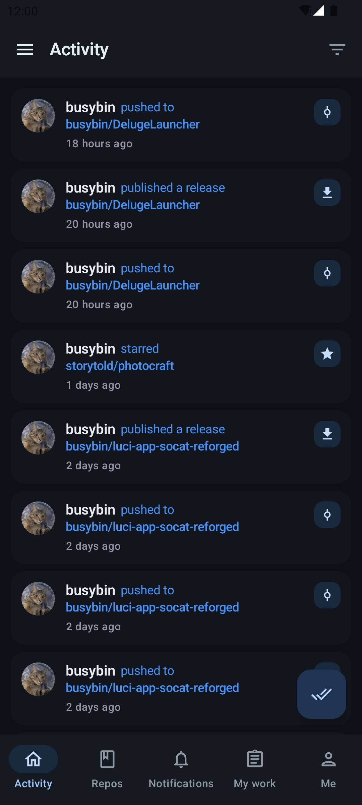
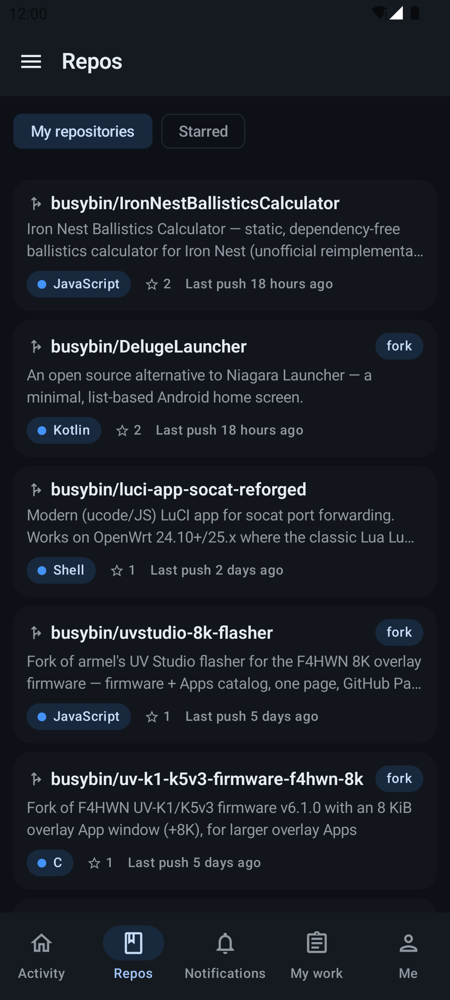
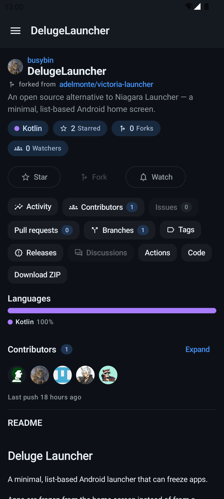
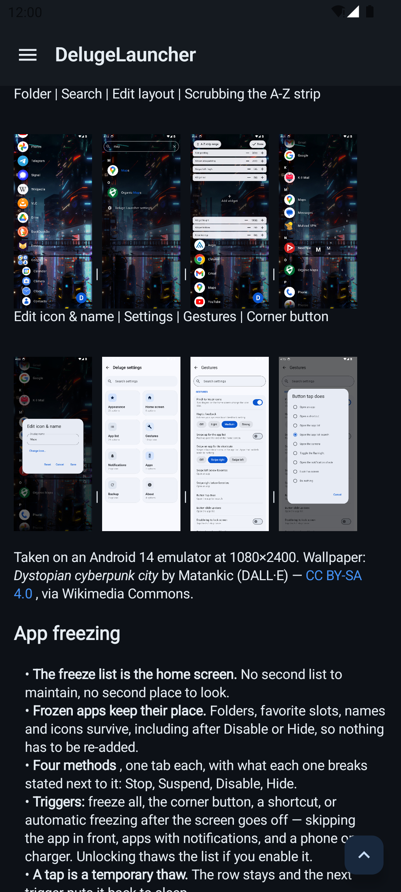
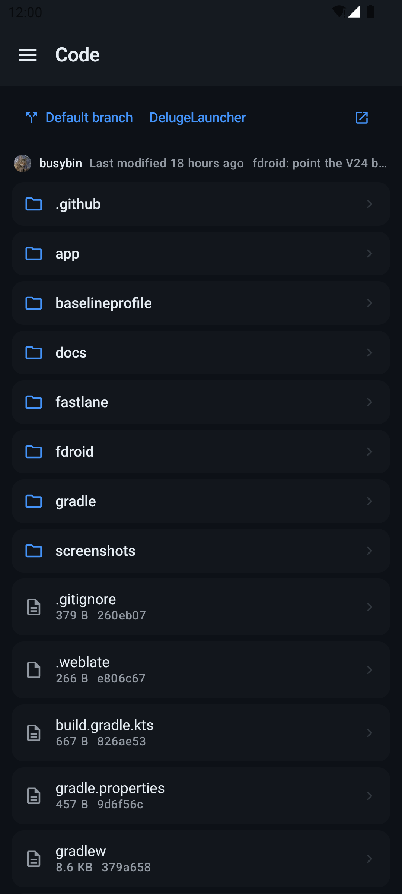
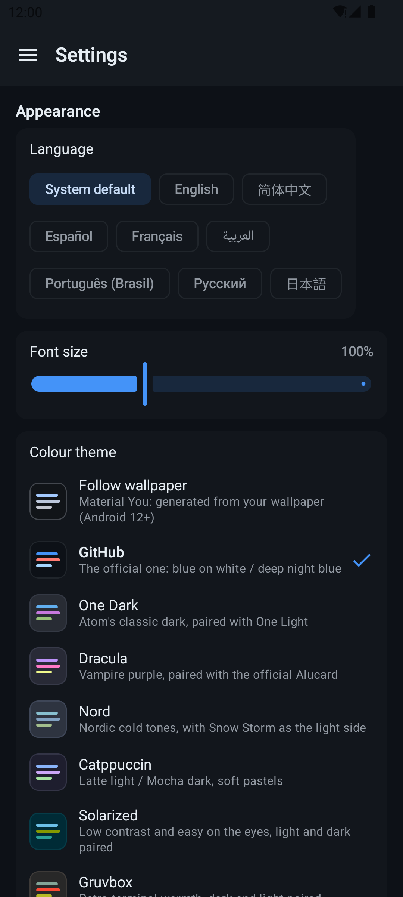

[](https://www.gnu.org/licenses/gpl-3.0)
[](https://github.com/busybin/gitrehub/releases/latest)

# GitRehub

<p align="center">
  <a href="https://buymeacoffee.com/busybin"></a>
</p>

An open-source GitHub client for Android with a modern **Material 3 / Jetpack Compose** interface.

Not affiliated with GitHub, Inc. GitRehub is an independent client for the public GitHub API; the
GitHub name refers only to the service, and no GitHub artwork or logo is bundled.

## Screenshots

| Activity | Repositories | Repository |
| --- | --- | --- |
|  |  |  |
|  |  |  |

Taken on an Android 14 emulator at 1080×2400.

## Features

**Interface**
- Material 3, dark only, nine colour themes (GitHub, Follow wallpaper, One Dark, Dracula, Nord, Catppuccin, Solarized, Gruvbox, Tokyo Night), four font sizes, comfortable/compact density
- Single-activity Compose UI with a navigation drawer, bottom bar, and two-pane layouts on tablets

**Activity feed**
- One merged stream: your received events, your own activity, and what other people did to *your* repositories (stars, forks, PRs, issues)
- **Filters**: event type, time range, source, read state, ordering, per-author, per-repository, keyword block-list, hide bots. Everything is saved and survives a restart; only “Clear filters” resets it
- “Mark all as read” shared with the notifications screen

**Repositories, issues, pull requests**
- Repository browser: rendered README, code browsing (directories, files, branches, tags) with line numbers and in-file search, releases with downloadable assets, activity and contributor pages
- Native issue/PR detail pages: labels, comments (edit and delete), reactions, assignees, milestones, lock, reviews, and comment/close/merge actions where your permissions allow
- Notifications with filtering, custom swipe actions, and mark-all-as-read
- Search repositories, users, issues/PRs and code; a My Work tab with your issues, PRs, reviews and mentions

**Accounts and data**
- Access-token login, device-code login (needs your own OAuth app), multiple accounts with switching, profile editing
- Offline cache (OkHttp disk cache) so what you browsed still shows without a network
- Update check against GitHub Releases (manual + opt-in automatic check)
- No ads, no trackers, no Google Play Services

## Install

Download the APK from [Releases](https://github.com/busybin/gitrehub/releases/latest) and sideload it.
Android 8.0 (API 26) or newer.

## Build

Gradle 9.8.1 / AGP 9.4.0, `compileSdk 37`, `minSdk 26`, Java 17.

```sh
./gradlew assembleDebug      # app/build/outputs/apk/debug/app-debug.apk
./gradlew testDebugUnitTest  # JVM tests
```

The repository ships **no** OAuth credentials. Plain access-token login needs none. To enable
device-code login, create your own GitHub OAuth App (with *Enable Device Flow* ticked) and put the
credentials in `app/secrets.properties` (not committed):

```properties
GITHUB_CLIENT_ID=…
GITHUB_SECRET=…
```

### Versioning

`versionName` and `versionCode` are the same plain number (`1`, `2`, …), and the release tag uses
that number too.

## Issues

Report bugs and feature requests at <https://github.com/busybin/gitrehub/issues>.

## License

GitRehub is free software under the **GNU General Public License v3.0** — see [LICENSE](LICENSE)
for the full text. Bundled third-party components and their licenses are listed in
[THIRD-PARTY.md](THIRD-PARTY.md).

GitRehub is a maintained successor of [FastHub-RE](https://github.com/LightDestory/FastHub-RE)
(GPL-3.0), which descends from [FastHub](https://github.com/k0shk0sh/FastHub) through
[FastHub-Libre](https://github.com/thermatk/FastHub-Libre) and
[zero's Kotlin port](https://github.com/zeromake/FastHub). The data layer and the user interface
have since been rewritten; copyright of the original code remains with its authors.
