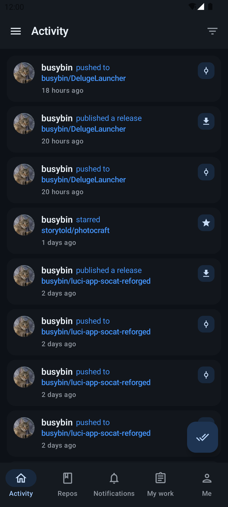
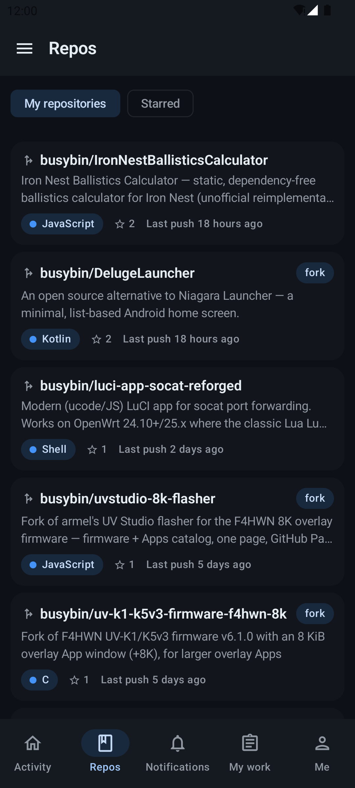
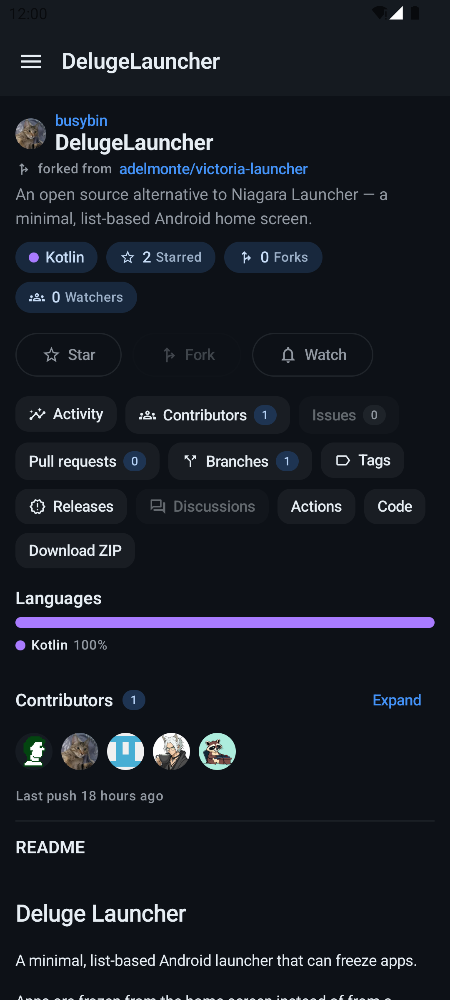
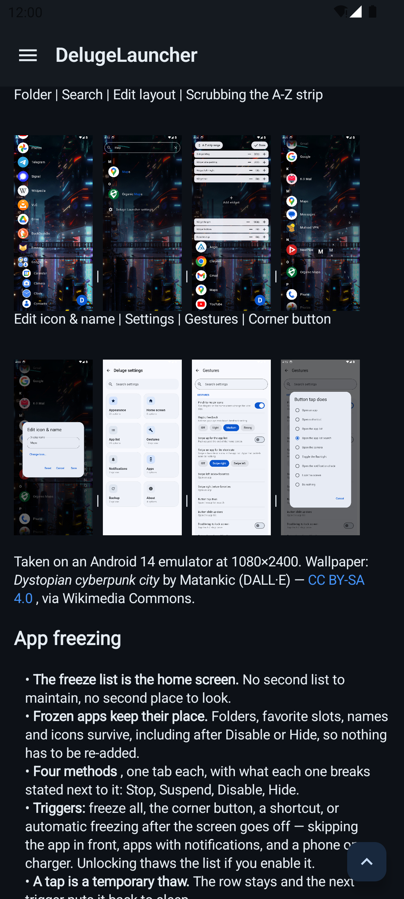
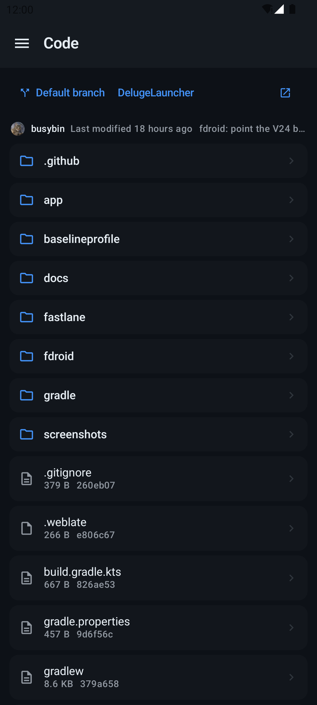
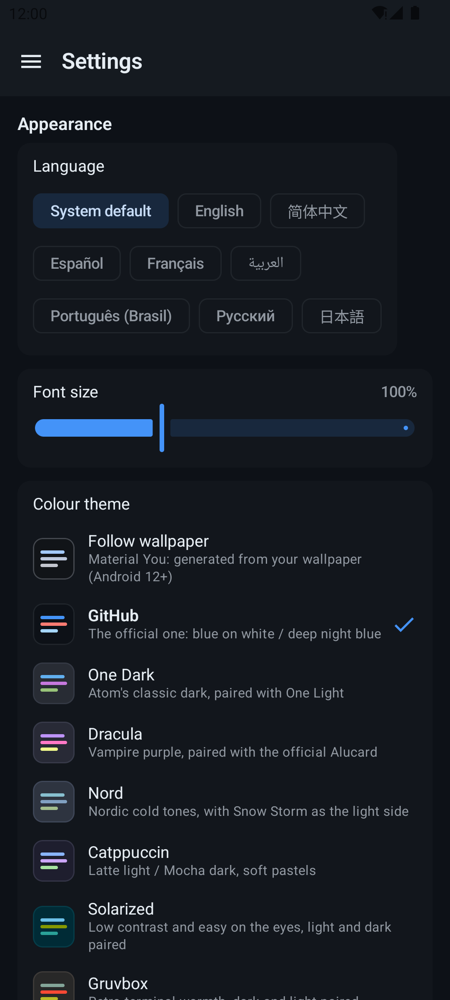

[](https://www.gnu.org/licenses/gpl-3.0)
[](https://github.com/busybin/gitrehub/releases/latest)

# GitRehub

An open-source GitHub client for Android with a modern **Material 3 / Jetpack Compose** interface.

Not affiliated with GitHub, Inc. GitRehub is an independent client for the public GitHub API; the
GitHub name refers only to the service, and no GitHub artwork or logo is bundled.

## Screenshots

| Activity | Repositories | Repository |
| --- | --- | --- |
|  |  |  |
|  |  |  |

Taken on an Android 14 emulator at 1080×2400.

## Features

**Interface**
- Material 3, dark only, ten colour themes (GitHub, Follow wallpaper, One Dark, Dracula, Nord, Catppuccin, Solarized, Gruvbox, Tokyo Night, AMOLED), four font sizes, density and line-height sliders
- Single-activity Compose UI: navigation drawer, bottom bar on phones, navigation rail and two-pane layouts on tablets
- Hardware-keyboard shortcuts (`Ctrl+K`, `Ctrl+1..5`, `Ctrl+,`, `Esc`), predictive back, eight languages with an in-app language switch

**Activity feed**
- One merged stream: your received events, your own activity, and what other people did to *your* repositories
- **Filters**: event type, time range, source, read state, ordering, per-author, per-repository, keyword block-list, hide bots; saved across restarts
- "Mark all as read" shared with the notifications screen

**Repositories**
- Rendered README with a section outline, badge/SVG images and in-page anchors
- Code browsing with line numbers, in-file search, wrap toggle, find-file, in-repository code search, per-file history and commit diffs
- Branches and tags, releases with downloadable assets, a release editor (draft, generate notes, compare with the previous release), contributors and stargazers
- Maintainer insights: 14-day views/clones, referrers, popular paths, Dependabot alerts, stale issues
- "Since your last visit": commits, issue activity and new releases on the repository screen
- Labels and milestones management, topics/description/homepage editing, watch levels

**Issues and pull requests**
- Native issue and PR pages: timeline of state changes and comments, labels, assignees, milestones, reactions, lock, edit, close/reopen
- PR review: per-file diffs, line comments, approve / request changes, resolve conversations, mark files as viewed, checks summary, update branch, draft toggle, auto-merge
- Issue templates, bulk triage (close/reopen, add label, assign), print/PDF export
- Discussions: categories, comments, accepted answers

**Gists**
- Browse your gists (secret ones included) and anyone's public gists; create, edit, delete; comments, revision history, star

**Search and My Work**
- Search repositories, users, issues/PRs and code; saved searches and pinned repositories
- My Work: assigned issues, review requests, mentions, your own issues and PRs

**Notifications**
- Filtering by type, repository, reason and time; custom swipe actions; mark-all-as-read
- Done (unsubscribe), inline reply from the notification shade, quiet hours, per-reason notification channels

**Offline**
- OkHttp disk cache so browsed screens still open without a network
- Save a whole repository: metadata, rendered README, text files and (optionally) issues/PRs, with automatic refresh when the default branch moves and a per-account quota shown on the Saved screen
- Save an issue or pull request for offline reading; copies are deleted when the account signs out

**Accounts and data**
- Access-token login, device-code login (needs your own OAuth app), multiple accounts with switching, profile editing
- Update check against GitHub Releases (manual + opt-in automatic check)
- No ads, no trackers, no Google Play Services

## Install

Download the APK from [Releases](https://github.com/busybin/gitrehub/releases/latest) and sideload it.
Android 8.0 (API 26) or newer.

## Build

Gradle 9.8.1 / AGP 9.4.0, `compileSdk 37`, `minSdk 26`, Java 17.

```sh
./gradlew assembleDebug      # app/build/outputs/apk/debug/app-debug.apk
./gradlew testDebugUnitTest  # JVM tests
```

The repository ships **no** OAuth credentials. Plain access-token login needs none. To enable
device-code login, create your own GitHub OAuth App (with *Enable Device Flow* ticked) and put the
credentials in `app/secrets.properties` (not committed):

```properties
GITHUB_CLIENT_ID=…
GITHUB_SECRET=…
```

### Versioning

`versionName` and `versionCode` are the same plain number (`1`, `2`, …), and the release tag uses
that number too.

## Issues

Report bugs and feature requests at <https://github.com/busybin/gitrehub/issues>.

## License

GitRehub is free software under the **GNU General Public License v3.0** — see [LICENSE](LICENSE)
for the full text. Bundled third-party components and their licenses are listed in
[THIRD-PARTY.md](THIRD-PARTY.md).

GitRehub is a maintained successor of [FastHub-RE](https://github.com/LightDestory/FastHub-RE)
(GPL-3.0), which descends from [FastHub](https://github.com/k0shk0sh/FastHub) through
[FastHub-Libre](https://github.com/thermatk/FastHub-Libre) and
[zero's Kotlin port](https://github.com/zeromake/FastHub). The data layer and the user interface
have since been rewritten; copyright of the original code remains with its authors.
